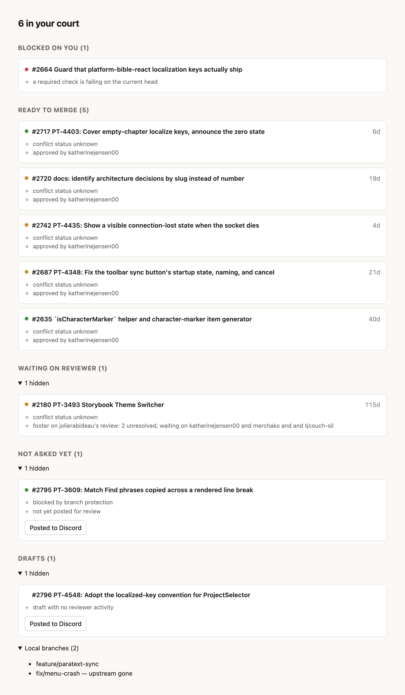
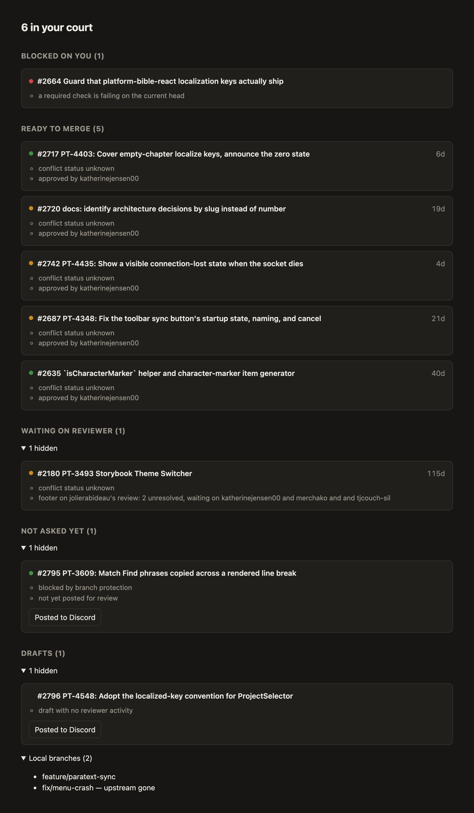

# PR Dashboard

A local dashboard that answers one question about your open pull requests: **whose
court is the ball in?** It polls GitHub, sorts your PRs into prioritized buckets
(blocked, needs your response, ready to merge, waiting on a reviewer, …), does the same
for other people's PRs you have reviewed, shows the receipts behind every verdict, and
notifies you when a PR changes court.

It runs entirely on your machine. Each person runs their own copy, tracking their own
GitHub login.

| Light | Dark |
| --- | --- |
|  |  |

*Both shots are `npm run demo` — the nine captured PRs in `tests/fixtures/`, not live
data. You can run exactly this yourself before configuring anything.*

## What you can do with this repo

| I want to… | Do this |
| --- | --- |
| See what the board looks like, with no setup | `npm install && npm run demo` |
| Track my own PRs | Configure `config.json`, then `npm run dev` |
| Understand why a PR landed in a bucket | Read the receipts on its card — every verdict explains itself |
| Stop a PR nagging me from "not asked" | Click **Posted to Discord** on the card |
| Change how PRs are classified | Edit a rule in `src/rules/`, add a fixture test |
| Check my changes didn't break classification | `npm test && npm run typecheck` |
| Refresh the captured PRs the tests run against | `npx tsx scripts/capture-fixtures.ts 2717 2720 …` |

## Try it without any setup

```bash
npm install
npm run demo
```

Open <http://localhost:5173>. This serves a board built from the nine real PRs
captured in `tests/fixtures/`, pinned to a fixed clock so it looks the same every
time. It never contacts GitHub, never shells into a clone, never calls Claude, never
sends a notification, and never writes to your database — so it works before you have
a `config.json`, and it is safe to leave running.

Demo mode is also what produces the screenshots above.

## Prerequisites

Node is needed for everything, including the demo. The rest are needed only for
the real board (`npm run dev`).

| | |
| --- | --- |
| **Node 22+** | Needed even for the demo: `npm install` builds the `better-sqlite3` native module, and an older Node fails at that step. |
| **GitHub CLI, logged in** | The server reads your token from `gh auth token` at startup. Run `gh auth login` first. No token is ever stored in this repo. |
| **A local clone of your home repo** | The branch list reads it with `git -C`. Nothing is written to it. |
| **`ANTHROPIC_API_KEY`** | Optional. Used only to break ties on ambiguous reviews — see [Review escalation](#review-escalation). |
| **A browser that allows notifications** | Optional. Native `osascript` notifications are macOS-only; browser notifications work everywhere. See [Known limits](#known-limits). |

## Quickstart

```bash
npm install
cp config.example.json config.json   # then edit it — see below
npm run dev
```

Open <http://localhost:5173>.

`npm run dev` starts two processes: the API on port 5174 and the Vite dev server on
5173, which proxies `/api` to the API. On startup the server prints which login and
repo it is tracking — check that line says *you*.

## The buckets

Every open PR lands in exactly one bucket. The first three are **your court** — they
are what the "N in your court" headline counts, they render expanded, and they are the
ones that can raise a notification. The rest collapse to a one-line summary you can
click open.

| Bucket | What puts a PR here |
| --- | --- |
| **Blocked on you** | A merge conflict, or a required check failing on the current head. Outranks everything, including a clean approval. |
| **Needs your response** | A reviewer acted after your last activity — or their Reviewable footer names you in "waiting on". |
| **Ready to merge** | An explicit approval with nothing after it, or a footer reporting all files reviewed and all discussions resolved. |
| **Waiting on reviewer** | You acted after their last activity, or the footer names someone else. |
| **Asked, nobody has looked** | You marked it posted to Discord and no reviewer has touched it since. Past `staleAfterHours` the card says to re-ping. |
| **Not asked yet** | No review activity has ever happened and you haven't posted it for review. |
| **Drafts** | A draft nobody has reviewed. Stays quiet — unless you mark it posted, which moves it to "asked, nobody has looked". |

Below the buckets is a plain list of your **local branches**, with `— upstream gone`
marked on any whose remote has been deleted. It is deliberately not a claim about
unsubmitted work: the GraphQL query doesn't fetch `headRefName`, so there's no honest
way to match a branch to its PR. A gone upstream is the only distinction the data
supports.

## Others' PRs

The second tab, **Others' PRs**, lists open PRs written by other people that *you* have
reviewed or commented on, sorted by whose turn it is. Only PRs you have already touched
appear: a review that was requested of you but that you have never opened, reviewed or
commented on is deliberately **not** included. A card shows the author ("by alice") next
to the repo name and has no Posted to Discord button.

| Bucket | What puts a PR here |
| --- | --- |
| **Needs your review** | The newest Reviewable footer names you in "waiting on", or the author pushed or replied after your last review or comment. Renders expanded and counts toward the headline. |
| **Waiting on author** | A draft (always, whatever else is true), the newest footer names someone else, or you reviewed or commented after the author's last activity (or at the same moment). |
| **You approved** | Your newest review is an approval and the author has not commented since. A push after your approval does not pull it back, because Reviewable approvals survive pushes; a comment or thread reply from the author does. |
| **Gone quiet** | GitHub shows no activity on the PR for more than `quietAfterDays` days (default 30). Collapsed, not counted in the headline, never notifies. |

Rules run in this order and the first match wins: gone quiet, draft, Reviewable footer,
approved, who acted last. The card's receipts say which one it was.

**Review requests are ignored on purpose.** Being listed as a requested reviewer never
moves a PR, because many requests are automatic and say nothing about whether you will
look. Only what you have actually done on a PR matters.

The Reviewable-footer rule only applies when a review carries Reviewable's status footer.
With plain GitHub comments it never fires, and who acted last decides. A footer only
counts while nothing from you or the author is newer than the review carrying it. Only
your activity and the author's matter: other reviewers are ignored, as are logins in
`botLogins` (a bot's Reviewable footer is still read). The author's activity is their
pushes (a bare merge of main does not count), issue comments, review-thread replies and
reviews; yours is your reviews, issue comments and review-thread replies.

The headline counts both tabs: **N in your court** is your own PRs that need you plus the
reviews waiting on you. Under it, a one-line summary breaks that down ("2 on your PRs · 1
review waiting on you", or "Nothing waiting on you"), and each tab label carries its own
count, so you never have to open a tab to learn whether work is waiting there. The tab you
last used is remembered in your browser; the default is My PRs.

## Using the board

**Receipts.** Every card lists the evidence behind its bucket — which footer was read,
who acted last, which check is red. If a verdict looks wrong, the receipts tell you
which rule produced it.

**The check dot.** Red is a failing required check, amber is still running, green is
all complete and passing, and no dot means the PR has no checks at all. A rolled-up
`FAILURE` is not trusted on its own, because a run that was merely *cancelled* rolls
up that way.

**Posted to Discord.** On "not asked yet" and draft cards, this button stamps the PR as
asked-for-review and starts the staleness clock. That moves it to "asked, nobody has
looked" and stops it reading as something you've forgotten to send out. The stamp is
local to your database, not anything posted to GitHub or Discord for you.

**Notifications** fire when a PR *arrives* in "needs your response", "blocked on you",
or "ready to merge", when another person's PR arrives in "needs your review", and when a
Discord-posted PR goes stale. They are debounced 15
minutes and only re-fire when a PR actually changes state, so a PR sitting still stays
quiet. Clicking one opens the PR.

On every OS, click **Enable notifications** under the headline to get them as browser
notifications. The server decides when to notify; the open board shows each new one once
(however many tabs are open), and a board you open fresh shows no backlog. They work
while the tab is in the background or the window minimized, but not once the tab is
closed. On macOS the server also sends its own `osascript` notification, so enabling the
browser ones there doubles them up — a Mac user who prefers the native ones simply doesn't
enable browser notifications.

**Staleness.** If the API can't be reached the board keeps showing the last good data
behind a banner saying so, and keeps retrying every 30s rather than blanking out.

## Configuration

`config.json` is gitignored, so your copy stays yours. Every field is required except `scope` and `quietAfterDays`.

| Field | Meaning |
| --- | --- |
| `repoPath` | Absolute path to your local clone of the home repo. Used for the branch list. |
| `owner` / `name` | Your home repo, e.g. `paranext` / `paranext-core`. With the default scope this is the only repo polled. |
| `scope` | Optional. `"repo"` (the default) tracks your PRs in `owner`/`name` only; `"org"` tracks your open PRs in every repo of `owner`. |
| `me` | **Your** GitHub login. This is what "your court" is measured against. |
| `botLogins` | Logins whose reviews and comments don't count as human activity. |
| `pollIntervalMs` | How often to poll GitHub. Minimum 30000; 180000 (3 min) is the default. |
| `staleAfterHours` | How long a PR sits unlooked-at before the Discord nudge goes stale. |
| `quietAfterDays` | Optional. Days without activity after which another person's PR moves to "Gone quiet" on the Others' PRs tab. A positive number; defaults to 30. |

The example file ships with placeholders in angle brackets for the two fields that
must be yours. The server refuses to start while any placeholder is left in place, and
refuses to start if `repoPath` doesn't exist — both produce a message naming the field.

With `"scope": "org"`, every card carries a small muted label with its repo name
(`paratext-10-studio #202 …`) — shown on every card, in either scope — and notifications
are titled the same way. A PR is identified by repo plus number, so two repos that both
have a #205 stay separate, including their Discord stamps and notification state. The
branch list still covers only the home repo's clone at `repoPath`.

Environment overrides, all optional:

| Variable | Default |
| --- | --- |
| `PRD_CONFIG` | `config.json` |
| `PRD_DB` | `pr-dashboard.db` |
| `PORT` | `5174` (the API; the web port lives in `client/vite.config.ts`) |

## Review escalation

Most reviews are classified deterministically from the Reviewable footer and review
timestamps. Two cases are genuinely ambiguous — a `COMMENTED` review with no footer,
and an approval whose body still asks for changes — and those are sent to Claude to
decide whose court the PR is in. Verdicts are cached in SQLite per review revision, so
each review is escalated at most once.

This needs `ANTHROPIC_API_KEY` in your environment. **Without it the dashboard still
works**: the ambiguous PR falls back to its deterministic bucket and the card says the
tie-break is unavailable. Nothing crashes and nothing is retried in a loop.

## Architecture

```
src/
  rules/      classification — pure functions, no I/O. Start here.
    classify.ts   picks the bucket and writes the receipts
    footer.ts     parses the Reviewable footer
    activity.ts   who acted last, ignoring bots and bare merges of main
    checks.ts     failing checks, the check dot, conflict state
    reviewing.ts  buckets for other people's PRs you have reviewed
    notify.ts     what a notification is keyed on
  github/     GraphQL query, client, and `gh auth token` lookup
  git/        reads local branches via `git for-each-ref`
  claude/     tie-breaks the two ambiguous review shapes
  store/      SQLite: Discord stamps, cached verdicts, notification state
  notify/     macOS notifications via `osascript`
  server/     Fastify routes, the poll loop, and demo mode
client/src/   React board — App, Card, bucket labels and ordering
```

The seam worth knowing: `buildBoard()` in `src/server/poller.ts` is a pure function of
`(prs, branches, store, config, now, reviewingPrs)`. The poller wraps it with network I/O; demo mode
feeds it fixtures. That's why the demo needs no GitHub access.

**To change how PRs are classified**, edit `src/rules/classify.ts` and add a case to
`tests/classify-fixtures.test.ts`. Because the fixtures are real captured PRs, a rule
change that breaks a real-world case fails the suite.

**To add a new bucket**, it needs a `Bucket` member in `src/types.ts`, an entry in
`ORDER` (or `REVIEW_ORDER` for the Others' PRs tab) in `src/server/poller.ts`, and a
label in `client/src/buckets.ts`.

## Development

```bash
npm test          # vitest, one pass
npm run test:watch
npm run typecheck
```

Classification is covered by unit tests plus fixture tests built from nine real PRs in
`tests/fixtures/`. `scripts/capture-fixtures.ts` refreshes them — pass the PR
numbers to recapture, e.g. `npx tsx scripts/capture-fixtures.ts 2717 2720`. It needs
an authenticated `gh`.

## Known limits

- **Notifications need the board open.** Browser notifications work on every OS but only
  while the board is open in a tab; a closed tab gets none. The native `osascript`
  notifications are macOS-only and `notify()` is a no-op elsewhere, which the server says
  once at startup.
- **One user per checkout.** `me` is a single login, and the SQLite file holds that
  person's notification and Discord state. Teammates each clone and configure their
  own; don't share a working copy.
- **Polling, not webhooks.** Changes show up within one `pollIntervalMs`, not
  instantly.
- **`gh` is required at startup.** If it's missing or logged out, the server exits
  with an actionable message rather than running blind. Demo mode doesn't need it.
- **Branches aren't matched to PRs.** See [The buckets](#the-buckets).
- **The branch list is home-repo only.** With `"scope": "org"` the PRs span the org, but the
  branches still come from the single clone at `repoPath`.
